# Tutoriel d'installation du système de gestion oressource

Requis :


- Un ordinateur (fixe ou portable)

- Linux Mint ou Ubuntu installé dessus et un compte administrateur (dont on connait le mot de passe)

- Une connexion réseau (avec internet pour l'installation mais non obligatoire ensuite)

- Un café (ou 2 ! )


Une très grosse partie de l'installation se passera dans le terminal de commande. Lorsque l'on ouvre ce terminal, on peut remarquer
une partie en vert sous la forme XXXXXX@YYYYYYYY:~$. C'est ce que l'on appelle le « prompt ».


XXXXX : Votre nom d'utilisateur


YYYYY : Le nom de votre PC


Juste après se trouve un bloc blanc clignotant qui est le curseur. Celui-ci permet d'inscrire des « commandes » qui vont être
exécutées par l'ordinateur. Lorsqu'il est indiqué dans ce tutoriel « entrer une commande », cela signifie « saisir le texte au niveau du
curseur ».


Exemple : La façon classique de lancer le navigateur internet Firefox est de cliquer sur son icône sur le bureau. Cela ouvre le
programme « firefox ». Dans le terminal, il faudra inscrire « firefox » pour ouvrir Firefox.


NOTE IMPORTANTE 1 : Afin d'éviter des erreurs de saisie, il est possible de copier/coller les lignes de commande renseignées.
Pour coller une commande dans le terminal, il faut utiliser le raccourci « CTRL + MAJ + V ».
NOTE IMPORTANTE 2 : Dans l'informatique de tous les jours, lorsque l'on lance un téléchargement ou une installation, une barre
de progression nous indique l'état d'avancement. Dans le terminal, lorsqu'une commande s'est terminée, notre prompt (revoir plus
haut pour la signification) s'affiche de nouveau.


## INSTALLATION


Pour utiliser le système de gestion Oressource, il faut que l'ordinateur récupère et installe différents logiciels qui seront utiles pour
son fonctionnement. Pour cela, ouvrir le terminal en cliquant sur son icône.


La première étape consiste à ajouter un répertoire à notre liste de dépôt en entrant la commande :

```
sudo apt-add-repository ppa:ondrej/php -y
```

Le terminal demandera le mot de passe du compte Linux administrateur.


Explications pour ceux qui le souhaitent :


Sudo : demande de droits d'administration
Apt-add-repository : pour ajouter un dépôt de paquet
ppa:ondrej/php : présent chez l'utilisateur ondrej dans la rubrique php


- y : et valider automatiquement la commande

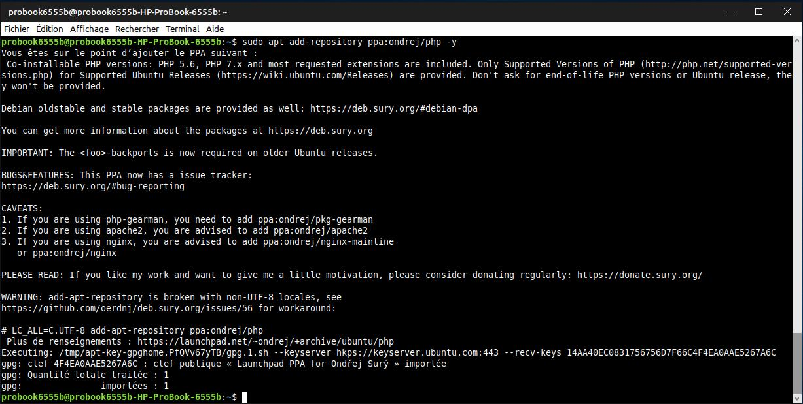

Ensuite, il faut télécharger et installer les logiciels dont nous aurons besoin. Pour cela :

```
sudo apt-get install apache2 git libapache2-mod-php mysql-server php8.1 php8.1-mysql phpmyadmin -y
```

De nouveau, il vous sera demandé votre mot de passe administrateur.


Explications pour ceux qui le souhaitent :


Sudo : demande de droits d'administration (toujours pareil)
Apt-get-install : pour lancer les installations des paquets suivants
Apache2 : logiciel de serveur HTTP
Git : Système de contrôle de version
Libapache2-mod-php : Module PHP ajouté à Apache2
Mysql-server : Service de base de données
Php8.1 : Mise à jour du langage PHP
Php8.1-mysql : Prise en charge MySQL dans php8.1
Phpmyadmin : Application Web de gestion de base de données mysql


-y : Et confirmera automatiquement la commande

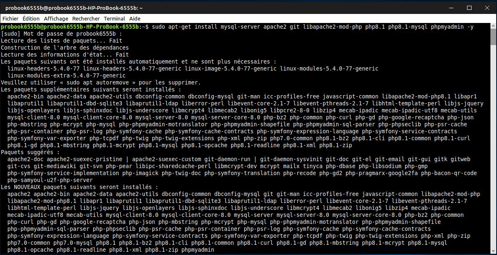

Une fenêtre bleue va s'ouvrir au bout d'un certain temps.

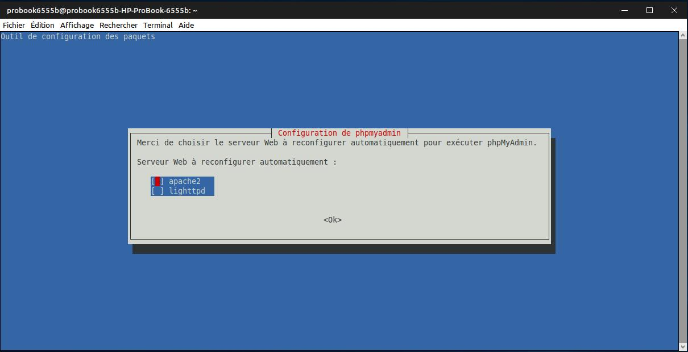


Il faut sélectionner « apache2 » avec la barre espace (un * va se mettre en face de apache2).

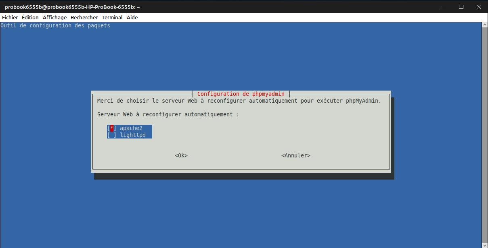

Appuyer ensuite sur « TAB » pour accéder à OK.

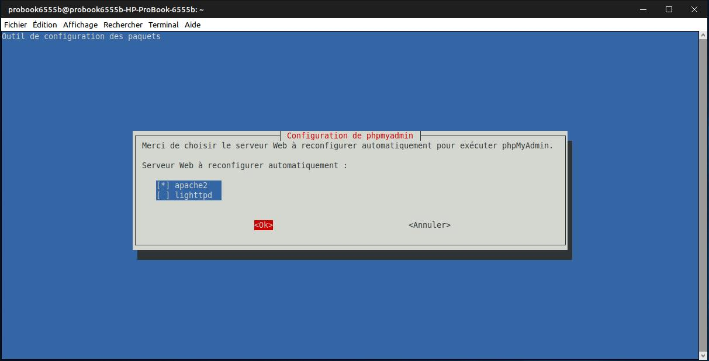

Appuyer sur Entrée et une nouvelle fenêtre va vous proposer de préconfigurer la base de données, ce qui n'est pas nécessaire
dans notre cas.

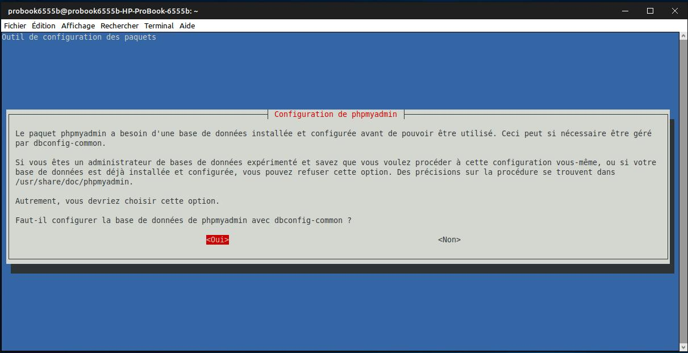


pouvez donc aller sur « NON » avec la flèche de droite et faire Entrée.


Vous


Ensuite, des lignes de commande vont apparaître au fur et à mesure que des paquets s'installent. Prenez maintenant le café en
attendant que cela se termine.
Lorsque tout sera terminé, le prompt apparait de nouveau.

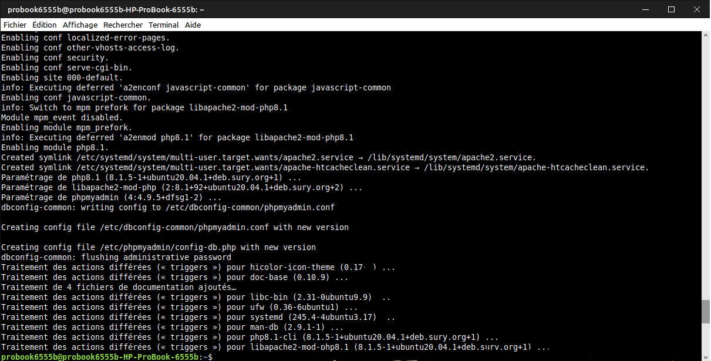

## MISE À JOUR


Il est recommandé de récupérer les dernières versions de nos paquets. Pour cela :

```
sudo apt-get update && sudo apt-get upgrade -y
```

Explications pour ceux qui le souhaitent :


Sudo : plus la peine de le présenter, il demande les droits en administrateur
Apt-get update : pour rechercher les mises à jour disponibles pour notre système
&& : et va lancer la seconde commande (indiquée après donc) si et seulement si la première s'est bien déroulée
apt-get upgrade : pour installer les mises à jour disponibles


-y : et confirmer automatiquement la commande

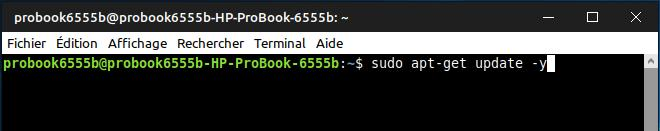

Ensuite, nous allons récupérer le projet sur le site de github via cette commande :

```
git clone https://github.com/mart1ver/oressource.git
```

Explications pour ceux qui le souhaitent :


Git clone : va cloner un répertoire présent à l'adresse qui suit sur notre ordinateur
https://github.com/mart1ver/oressource.git : à cette adresse

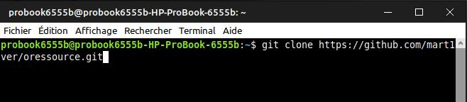

Les fichiers nécessaires au bon fonctionnement du système sont maintenant présents sur notre ordinateur, il reste maintenant à
configurer tout ça.


## CONFIGURATION INITIALE


Pour accéder à notre système, il faut maintenant créer un utilisateur. Celui-ci aura un mot de passe associé qu'il vous faut choisir.
Cet utilisateur agira dans notre serveur et aura certaines permissions d'accès pour mener à bien des opérations. Enfin, une base
de données sera également créée.


L'utilisateur sera appelé « oressource ».
Son mot de passe sera celui que vous choisirez. (ici : admin123)
Le serveur d'action sera localement hébergé sur notre ordinateur, ce sera donc « localhost ».
Les permissions d'accès seront totales et matérialisées par « all privileges ».
Notre base de données s'appellera « oressource ».


Entrons donc dans la matrice en saisissant cette commande :

```
sudo mysql --user=root --host=localhost -e \
```

Explications pour ceux qui le souhaitent :


Mysql : va lancer le shell mysql


- --user=root : avec le superutilisateur « root » créé initialement dans toute base de données

- --host=localhost : et ciblera l'hôte local pour s'effectuer

- e : en exécutant la commande


\ : _______

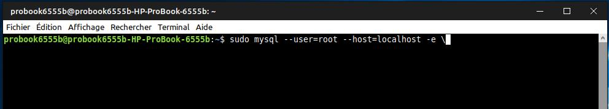

Un signe > va apparaitre, indiquant que l'on s'adresse maintenant au shell « mysql ».

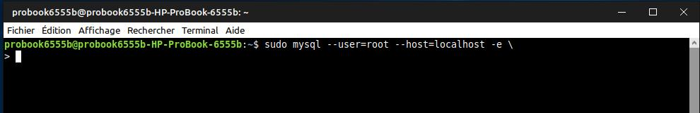


Il faut saisir alors :

```
"CREATE USER 'oressource'@'localhost' IDENTIFIED BY 'admin123';
```

Attention : sur cette première commande, bien remplacer le mot de passe « admin123 » par votre mot de passe


GRANT ALL PRIVILEGES ON oressource.* TO 'oressource'@'localhost';


CREATE DATABASE oressource;"


Explications pour ceux qui le souhaitent :


" : indique une série de plusieurs lignes, qui se terminera lorsqu'un nouveau " apparaitra.
CREATE USER : va créer un utilisateur 'oressource' dans (@) l'hôte 'localhost' identifié par le mot de passe 'admin123'. Ceci est
votre mot de passe de base de données.
; : permet de passer à la ligne
GRANT ALL PRIVILEGES ON : va attribuer un accès total à la base de données « oressource » à l'utilisateur 'oressource' dans
l'hôte 'localhost'
CREATE DATABASE oressource : va créer une base de données appelée oressource
" : termine la série de commandes

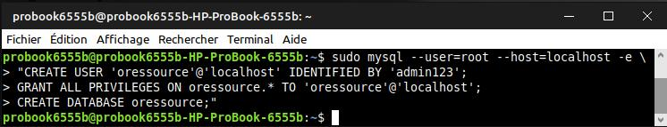

Si tout s'est bien passé, le prompt apparaitra de nouveau.


Il faut ensuite charger les données contenues dans la base de données fournie.


ATTENTION : bien remplacer dans la ligne suivante le X par votre nom d'utilisateur présent en tout début de ligne de terminal
(dans l'exemple, « probook6555b »)

```
sudo mysql --user=oressource --host=localhost --database=oressource -p < /home/X/oressource/mysql/oressource.sql
```

Explications pour ceux qui le souhaitent :


Mysql : va lancer le shell mysql


- user=oressource : cette fois ci, en tant qu'utilisateur nouvellement créé « oressource »

- host=localhost : toujours dans l'hôte local

- database=oressource : et va relier la base de données « oressource »

- p : pour laquelle un mot de passe est nécessaire et nous sera demandé juste après

- < /home/X/oressource/mysql/oressource.sql : à la base de données oressource.sql située dans le répertoire indiqué

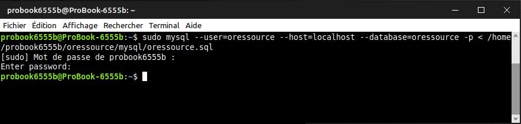

Le terminal vous demandera en premier lieu le mot de passe utilisateur. Ensuite, le « Enter password » vous demande le mot de
passe de la base renseigné à l'étape précédente (pour l'exemple, nous avions pris admin123)


Cette commande est un peu longue et aucune barre de progression ne s'affichera. Mais soyez patient, lorsque le prompt
réapparaitra, c'est que tout est ok.

## MISE EN PLACE DU SERVEUR

Il faut maintenant préparer l'hôte virtuel pour que notre système de gestion voit le jour et que l'on puisse s'y connecter. Pour cela :

```
sudo cp -pr oressource/ /var/www/oressource
```

Explications pour ceux qui le souhaitent :


Cp : lance une copie


-pr : en préservant les attributs d'origine


oressource/ : du dossier oressource (situé dans /home)
/var/www/oressource : dans un dossier situé dans le répertoire var, dossier www,


dossier oressource

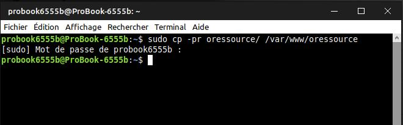

Nous allons attribuer les droits d'accès au répertoire. Pour cela :

```
sudo chown -R www-data:www-data /var/www/oressource
```

Explications pour ceux qui le souhaitent :


chown : lance un ajout de droits d'accès


-R : en opération récursive


www-data : à l'utilisateur « www-data »
:www-data : présent dans le groupe « www-data »
/var/www/oressource : du dossier « oressource » situé dans le répertoire var,

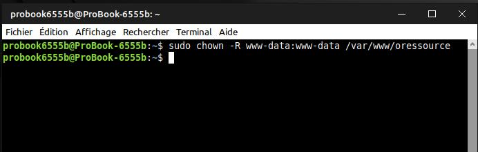

dossier www


Maintenant, nous allons changer de répertoire de travail pour aller modifier notre futur site. Pour cela :


cd /var/www/oressource/moteur/


Explications pour ceux qui le souhaitent :


Cd : va déplacer le répertoire de travail du terminal dans un nouveau dossier
/var/www/oressource/moteur : appelé « moteur » et situé dans le répertoire var, dossier « www », dossier « oressource »


Maintenant, une ligne bleue est apparue derrière le prompt.

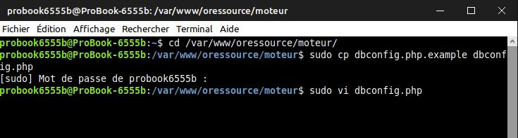

Il faut créer une copie d'un fichier de base que nous allons personnaliser. Pour cela :


sudo cp dbconfig.php.example dbconfig.php


Explications pour ceux qui le souhaitent :


cp- lance un copie
dbconfig.php.example : du fichier dbconfig.php.example
dbconfig.php : en un nouveau fichier appelé dbconfig.php


Il nous faut donc remplir ce fichier. Pour cela :

```
sudo vi dbconfig.php
```

Explications pour ceux qui le souhaitent :


vi : lance l'éditeur de fichier Vi dans le terminal
dbconfig.php : pour ouvrir le fichier dbconfig.php


Et nous allons maintenant le modifier : ATTENTION, BIEN SUIVRE TOUTES LES ETAPES ! (si la tasse de café est vide, c'est
le moment de s'aérer les méninges, de remplir de nouveau la tasse et de prendre une grande inspiration).


Voilà le fichier avant et l'endroit où vous allez devoir bidouiller :

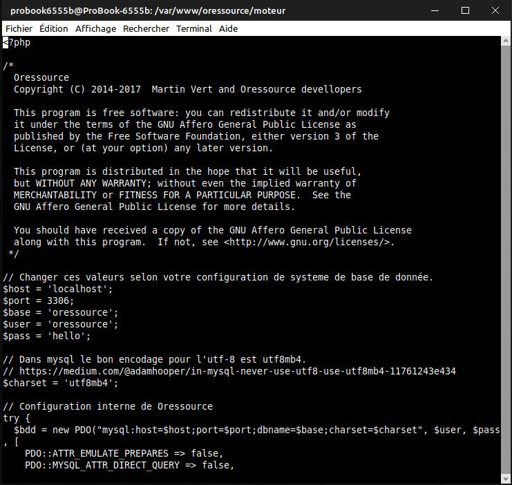


Se déplacer à l'aide des touches directionnelles jusqu'à la ligne $pass = 'hello' et placer le curseur sur le H de hello.


Appuyer 5 fois sur la touche « Suppr » du clavier pour enlever l'ancien mot de passe.


Appuyer ensuite sur la touche « Inser » du clavier et entrer le mot de passe de la BASE (nous avons pris pour l'exemple
admin123).

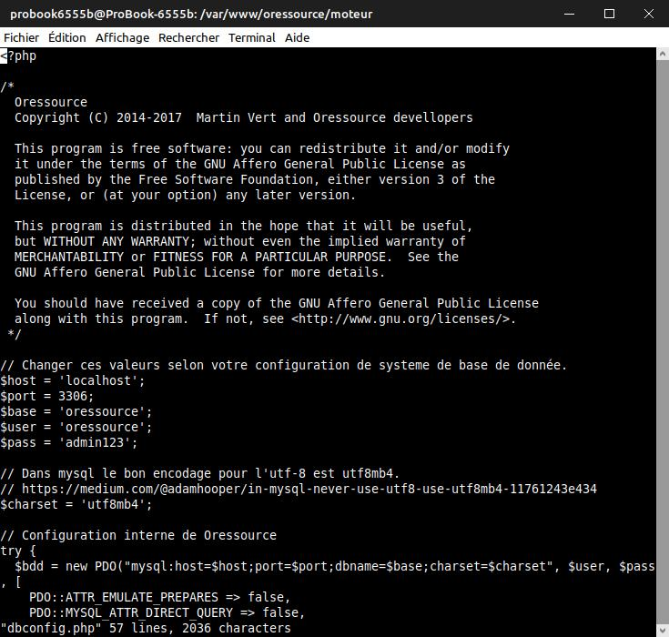


Appuyer ensuite de nouveau sur « Inser » puis sur la touche « : »


Un « : » devrait apparaitre tout en bas du terminal. (Si ce n'est pas le cas et que le « : » est apparu dans le mot de passe, appuyer
de nouveau sur la touche « Inser » avant de vous placer sur le « : » inséré en trop dans le mot de passe et le supprimer avec
« suppr »)

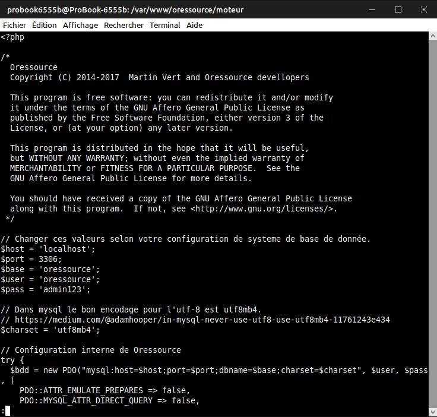


Inscrire wq

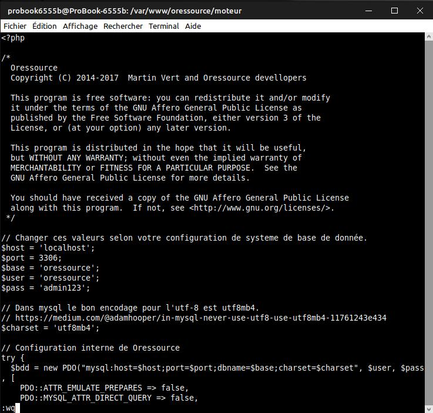

Appuyez sur « Entrée » pour sauvegarder les modifications.

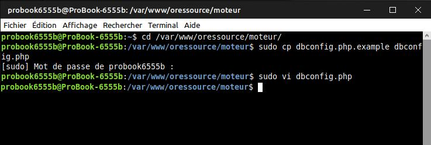

Nous sommes maintenant sortis de l'éditeur de fichier vi.


Saisir la commande :

```
cd ~
```

Explications pour ceux qui le souhaitent :


cd : va déplacer le répertoire de travail du terminal dans un nouveau dossier


~ : ici le répertoire de base symbolisé par ~

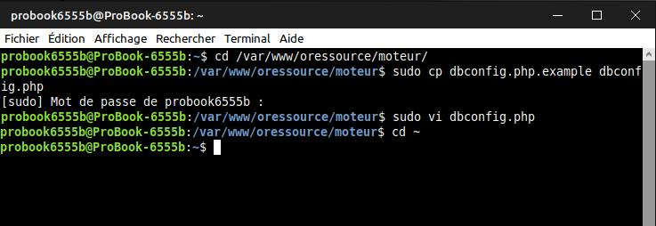

GRAND BRAVO A VOUS ! Le plus dur est passé !


Enfin, il reste quand même quelques étapes. Il nous faut maintenant entrer les caractéristiques http de notre serveur. Pour cela :

```
sudo vi /etc/apache2/sites-available/oressource.conf
```

Explications pour ceux qui le souhaitent :


vi : lance l'éditeur de fichier vi dans le terminal

/etc/apache2/sites-available/oressource.conf : en créant un fichier appelé oressource.conf

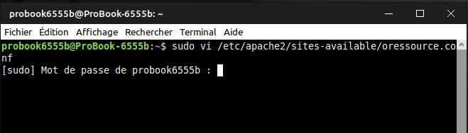


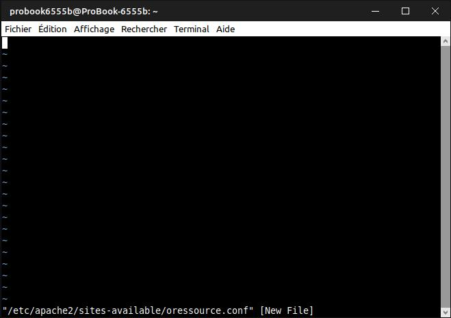

```
<VirtualHost *:80>
ServerName
DocumentRoot
ErrorLog
CustomLog
</VirtualHost>
```

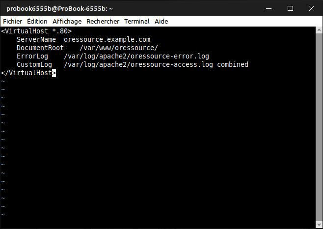

Copier/coller dans cette fenêtre vide le texte suivant (toujours avec le raccourci CTRL + MAJ + V) :

```
oressource.example.com
/var/www/oressource/
/var/log/apache2/oressource-error.log
/var/log/apache2/oressource-access.log combined
```

Appuyer sur « : » puis inscrire wq et appuyer sur « Entrée » pour sauvegarder vos modifications et quitter l'éditeur de fichier vi.

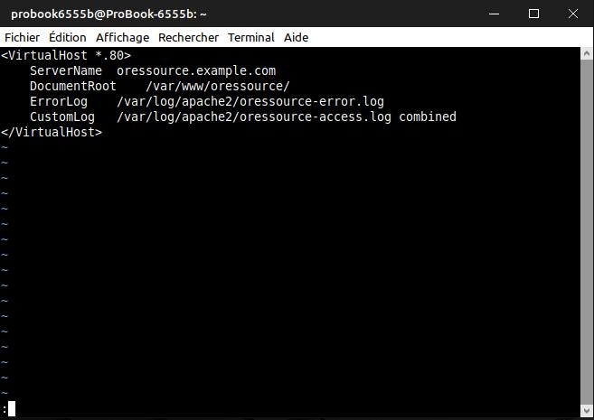
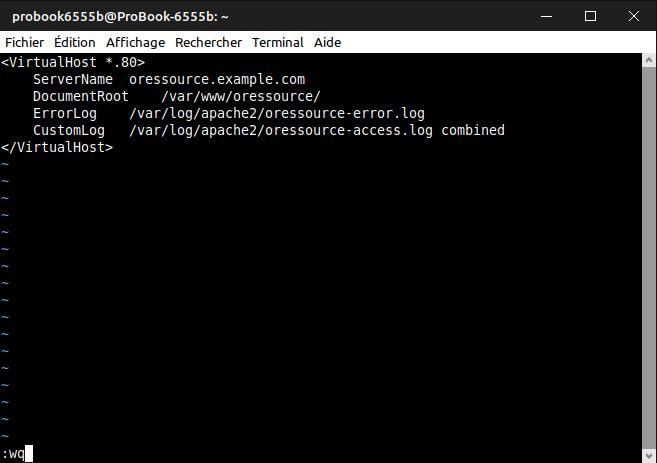


Nous allons maintenant activer le site « oressource ». Pour cela :

```
sudo a2ensite oressource
```

Explications pour ceux qui le souhaitent :


A2ensite : active le site apache2
Oressource : portant le nom de « oressource »

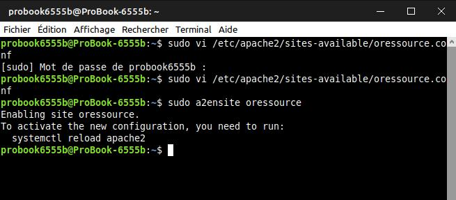

## REDEMARRAGE

Après toutes ces modifications, l'ordinateur va avoir besoin de redémarrer le service apache2 qui héberge notre site. Pour cela :

```
sudo systemctl restart apache2
```

Explications pour ceux qui le souhaitent :


Systemctl : appelle le système de gestion de services
restart : pour relancer
apache2 : le service apache2

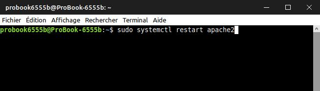

L'ensemble est maintenant pleinement fonctionnel. Il nous faut maintenant y accéder.

## ACCES AU SYSTEME

Pour accéder au système de gestion oressource que vous venez de mettre en route, il faut indiquer à l'ordinateur que vous allez
utiliser pour la saisie des ventes et collectes à quel endroit aller le chercher. Le fichier hosts (et cela est valable pour Linux, Mac ou
Windows) est un répertoire qui permet justement d'orienter les recherches de l'ordinateur. En le modifiant, vous pouvez donc
indiquer où aller le chercher.


Si votre but est d'utiliser un seul ordinateur dans votre ressourcerie pour héberger le système de gestion oressource et le gérer
(saisir les ventes et les collectes), il faudra d'indiquer à cet ordinateur que lorsque l'on recherche l'URL de oressource, il va
chercher en local (127.0.0.1) plutôt que sur Internet en modifiant son propre fichier hosts : vous êtes alors dans le CAS DE
FIGURE 1 : MONO ORDINATEUR.


Si vous souhaitez héberger le système de gestion oressource sur un ordinateur dédié (dans une baie informatique par exemple) et
utiliser d'autres ordinateurs pour saisir vos collectes et ventes, il faudra modifier le fichier hosts de chaque ordinateur pour lui
pointer d'aller visiter l'ordinateur dédié : vous êtes alors dans le CAS DE FIGURE 2 : MULTI ORDINATEURS.


CAS DE FIGURE 1 : MONO ORDINATEUR


Modifier le fichier hosts de l'ordinateur en y ajoutant l'adresse de notre site. Pour cela :

```
sudo vi /etc/hosts
```

Explications pour ceux qui le souhaitent :


vi : lance l'éditeur de fichier vi dans le terminal
/etc/hosts : pour modifier le fichier hosts de l'ordinateur

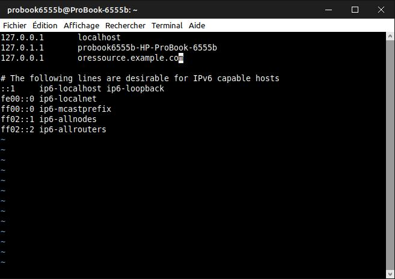

Nous allons y ajouter la ligne suivante, comme sur la capture d'écran :

```
127.0.0.1 oressource.example.com
```

Appuyer sur « : » puis inscrire wq et appuyer sur « Entrée » pour sauvegarder vos modifications et quitter l'éditeur de fichier vi.


Ouvrer maintenant le lien suivant avec votre navigateur préféré et vous devriez arriver sur votre système de gestion oressource.


oressource.example.com


Le premier compte par défaut est :
Courriel :
Mot de passe :


Félicitations à vous ! Vous avez réussi avec succès à installer et configurer oressource !


CAS DE FIGURE 2 : MULTI ORDINATEURS


Il faut d'abord connaitre l'adresse que possède notre ordinateur qui héberge le système de gestion.


Pour cela, ouvrir un terminal sur l'ordinateur que vous venez d'user en lui indulgeant tant de lignes de commande

```
ifconfig
```

Explications pour ceux qui le souhaitent :


ifconfig : permet de configurer et d'afficher les informations des cartes réseaux IP de l'ordinateur


Question : utilisez-vous une connexion wifi ou bien un câble réseau pour fournir le réseau Internet à votre ordinateur ?


En fonction de votre réponse, les résultats de cette commande seront différents. Le cas le plus probable étant que votre ordinateur
« serveur » utilise un câble réseau, nous allons continuer les explications dans ce sens.

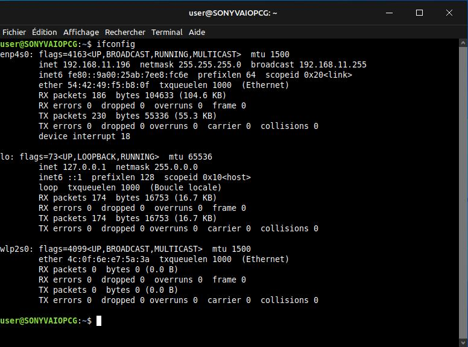
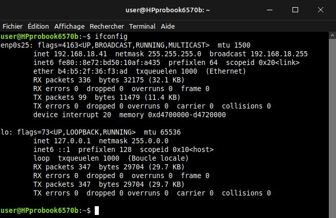

**Adresse IP de votre serveur**
**Masque de sous réseau**
**Nom de l'interface réseau**


Si vous utilisez le wifi, vous vous reporterez à l'interface réseau commençant par W (première capture par exemple : wlp2s0).


Une adresse ipv4 sous la forme 000.111.222.333 vous sera indiquée (marquée en rouge). Il s'agit de l'adresse IP que possède
votre serveur. Sur nos 2 exemples, on peut voir les adresses IP 192.168.11.196 et 192.168.18.41


Il est cependant plus probable que votre ordinateur vous affiche une adresse IP 192.168.1.XXX


Il est recommandé de définir pour cet ordinateur qui hébergera votre système de gestion une adresse IP fixe afin que vous puissiez
toujours le retrouver. De très nombreuses façons existent pour effectuer cela, que ce soit sur votre ordinateur ou sur votre réseau
(box, routeur, etc...) : elles présentent toutes des avantages/inconvénients que nous n'allons pas présenter ici. En recherchant un
peu sur le web, vous trouverez à coup sûr des informations complémentaires sur votre cas de figure précis. Nous allons donc voir
la méthode la plus simple qui consiste à demander à notre carte réseau de se présenter toujours sous la même adresse (celle que
nous venons d'afficher) sur le réseau.


Ouvrez les paramètres système de l'ordinateur à la rubrique « réseau ».

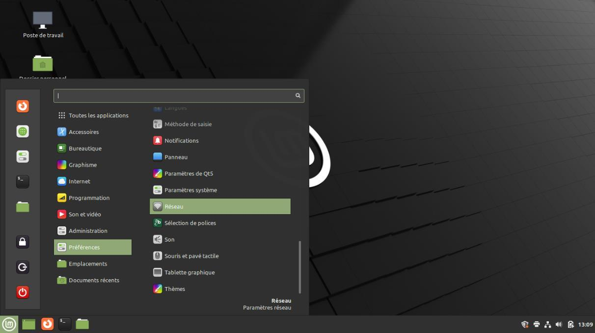

Ouvrez l'onglet « filaire » (ou « wifi » pour ceux qui utilisent une connexion wifi).

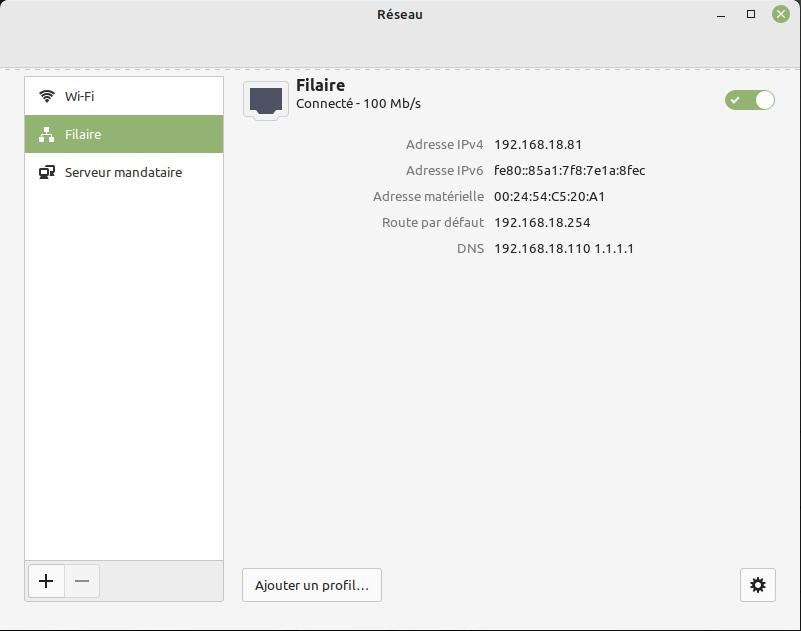

**Adresse IP de votre serveur**

**Route par défaut**

**Nom de l'interface réseau**


Vérifiez bien que les informations affichées sur votre connexion active correspondent à celles que vous avez trouvé avec ifconfig.


Notez au passage l'adresse mentionnée de la « route par défaut ».


Cliquez sur la roue de réglage.


Rendez-vous dans la rubrique « IPv4 ».

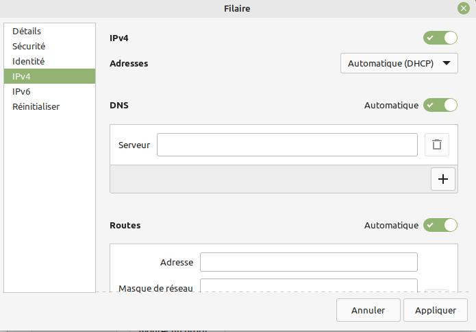

En face de « adresses », il doit être indiqué « Automatique (DHCP) ». Sélectionnez « Manuel ».

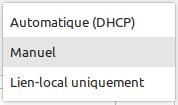

Complétez les champs :


- Adresse : correspond à la rubrique « inet » ou « adresse IPv4 »

- Masque de sous réseau : correspond à la rubrique « netmask »

- Passerelle : correspond à la rubrique « route par défaut »

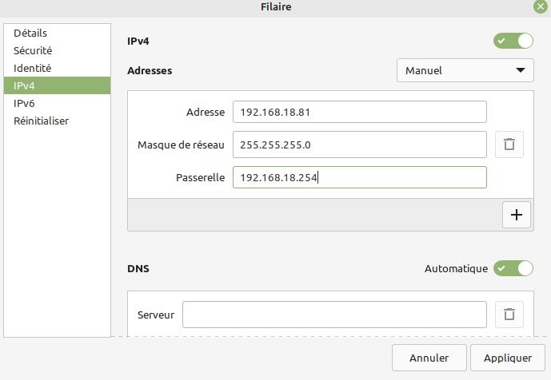

Une fois que vous avez effectuez cela, votre ordinateur « serveur » gardera son adresse et votre ordinateur «
retrouver.


client »


pourra le


Ensuite, sur l'ordinateur que vous souhaitez utiliser pour vos saisies (appelé client), localisez votre fichier hosts.


- Windows : C:\Windows\System32\drivers\etc\hosts

- Mac : /etc/hosts

- Linux : /etc/hosts


Ouvrez ce fichier et modifiez-le.


- Sur Windows, installez le logiciel « notepad++ », faites un clic droit sur votre fichier « hosts » et « edit with notepad++ »

- Sur Mac : lancez la commande :

```
sudo nano /etc/hosts
```

- Sur Linux, lancez la commande :

```
sudo vi /etc/hosts
```

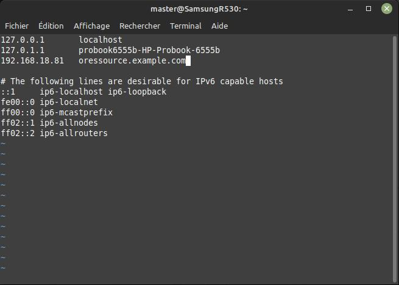

Lorsque le fichier hosts est ouvert, il vous suffit d'ajouter une ligne qui indiquera à votre ordinateur « client » que,
demandez de rechercher votre site, il doit regarder à l'adresse IP de l'ordinateur « serveur ».


lorsque vous lui


Pour cela, ajoutez une ligne et copiez-collez la ligne suivante :


192.168.XXX.YYY oressource.example.com


Où :


192.168.XXX.YYY est l'adresse IP de votre serveur (pour l'exemple, 192.168.18.81)


Et :


oressource.example.com est l'URL d'accès à votre système de gestion.


Sauvegardez le fichier :


- Sur Windows : ctrl + s (il est possible que vous ayez à valider les paramètres en tant qu'administrateur)

- Sur Mac :


Ctrl + 0 pour enregistrer vos modifications


Ctrl + X pour quitter l'éditeur.


- Sur Linux :


Appuyer sur « : » puis inscrire wq et appuyer sur « Entrée » pour sauvegarder vos modifications et quitter l'éditeur de fichier vi.


Actuellement, si toutes les étapes se sont correctement terminées (et si vous n'avez pas jeté l'ordinateur par la fenêtre), vous
pouvez enfin accéder à votre système de gestion « oressource » en ouvrant un navigateur internet et en y saisissant l'adresse
suivante :

```
oressource.example.com
```

Félicitations à vous ! Vous avez réussi avec succès à installer et configurer oressource !
